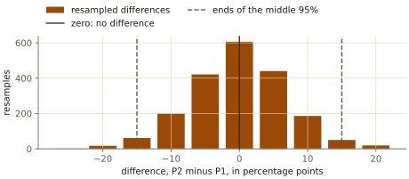

# Measure an assistant before you change it

By the end of this chapter you can measure a documentation assistant with a fixed set of questions, read the result with its interval, and say when twenty questions are too few to tell two prompts apart.

The assistant in this book answers questions about sablefile, a command-line tool that keeps a project's generated files in step with the templates they come from. Users ask how to run a command or what a setting does, and the assistant answers from the tool's documentation, citing the section behind each statement. Suppose someone on the team wants a different prompt. They try it on three questions, the answers look better, and they ship it. Three questions can't show whether the change helped. Nobody can say what the assistant did before the change either, because nothing was written down.

So the first thing to build is a measurement: a set of questions with the answers they should get, a way to run the assistant on them the same way each time, and a number that comes with its size. Changes come after that. This chapter builds the measurement in its simplest form, and it ends by showing where that form stops.

## The tool and its docs {#the-tool-and-its-docs}

An evaluation is only as steady as the thing it measures. The sablefile docs come in three versions, 1.0, 1.1 and 2.0, and they disagree in places. An answer that is right for one version can be wrong for another, so every question has to name its version before anything else about it is settled.

Start with the docs. Load the three versions, count the sections in each, and count the section IDs that all three share.

[Example: list-the-docs](../examples/list-the-docs.py)

The output opens with the section counts: {{out:list-the-docs:sections in version 1.0}} in 1.0, {{out:list-the-docs:sections in version 1.1}} in 1.1, and {{out:list-the-docs:sections in version 2.0}} in 2.0.

Most sections keep their IDs across versions, since {{out:list-the-docs:section IDs in all 3 versions}} IDs appear in all three. The last line matters most for what follows. {{out:list-the-docs:section IDs in 2.0 but in neither 1.0 nor 1.1}} IDs exist only in 2.0, so an assistant that answers from the older pages has nothing to cite for them.

The versions also differ in what the tool does, and the difference that matters here is in `sync`, the command that writes the generated files. The 1.1 docs say that `sync` with no flags writes the files and records each one in `sablefile.lock`, the lock file in the project root. The 2.0 docs say that `sync` with no flag prints a plan and writes nothing, that `--apply` writes the files, and that the lock file lives at `.sablefile/lock.json`. A question about `sync` has one right answer for 1.1 and another for 2.0. An assistant that reads the wrong version's page sounds sure of itself and is wrong.

This book measures answers. Retrieval ranking, tracing, cost, latency, attacks and agents' task sets belong to other books, named where they come up.

**Working rule:** Write the version into every question, and let that version's own docs be the only source for its answer. When two versions use the same wording and give different answers, make them two items, one for each version. Never let the newest version's page stand in for an older one.

## The twenty items {#the-twenty-items}

A test set is a list of questions, each with the answer it should get. Twenty items is deliberately small. You can read each one, check its expected answer against the docs, and say why it is there. A set nobody reads can't tell you what it measures.

The items fall into four kinds. Answerable items have their answer on the page. Unanswerable items ask about something the docs don't cover, and the right reply is the decline. Version-dependent items have an answer that changes from one version to the next, and several of them have a twin: the same question asked about another version. Ambiguous items could mean two things, and their reference answer covers both readings.

Each item is printed in ID order, with its version, kind, twin and whether it was planted.

[Example: twenty-questions](../examples/twenty-questions.py)

The last lines give the make-up of the set by kind, and answerable items are the largest group. {{out:twenty-questions:planted items}} items are planted. A planted item was written to catch one particular mistake, and the set labels it, so a failure on that item can be read against its trap.

Each trap is simple. `q-0003` asks whether `${project}` is the right placeholder in 1.0, where the syntax is `{{project}}`. Its twin, `q-0004`, asks the same about 2.0, where `${project}` is right. `q-0005` asks whether 2.0 still reads `sablefile.lock` in the project root, which uses the 1.x file name for a version where that name matters only for migration. `q-0015` asks what the `--dry-run` flag does in 1.0, and the 1.0 docs name no such flag. `q-0019` asks whether a file fails a check after you edit it, without saying which file, so it has two readings.

**Working rule:** Write each item with its version, its kind and its expected answer before you run the assistant, and label any item written to catch a specific mistake. Keep the set small enough to read in one sitting, and never change an expected answer to fit what the assistant said.

## Retrieve, then answer {#retrieve-then-answer}

The assistant doesn't read all the docs for every question. For each question it takes the three sections most likely to hold the answer, from the index of the version the question names, and answers from those three alone. A wrong answer can therefore come from two places: the right section was never retrieved, or the model misread the section it was given. A measurement that can't tell these apart can't say what to fix.

The index is built with BM25, which scores each section by the words it shares with the question, giving rarer words more weight and long sections less. The scoring runs through bm25s at {{version:bm25s}}. Take one question: whether an ignore entry such as `docs/**/*.tmp` catches a file two folders down in 1.1. Its output shows the words the index keeps from the question, and the top three sections, ordered by score and then by section ID.

[Example: retrieve-top-sections](../examples/retrieve-top-sections.py)

Read the two lines of kept words before the ranking. The tokeniser drops every token of one character. The `a` in the question goes, and so do both `1`s of `1.1`, so the version number never reaches the index. That does no harm here, because each question is searched only in the index of its own version. The same rule takes the `3` out of `3.5mm`: what is left of `a 3.5mm jack` is `5mm jack`, so a question about a 3.5 mm jack can match only on `5mm`. Neither loss raises an error, and the second one changes what the index can find.

The ranking puts `ignore-recursive` first, the section on recursive ignore entries, and the next two are the section on creating folders and the one on ignore syntax. Ties are broken by section ID, so the same question gives the same three sections on every run.

**Working rule:** Check retrieval before you check the answer. For each item, record the sections the assistant was given next to its reply. A wrong reply that lacks the right section is a retrieval problem, and a wrong reply that had the right section is a problem with the prompt or the model. Keep the wording of questions plain, because a tokeniser that drops one-character tokens will lose a measurement or a version number.

## Replay the answers {#replay-the-answers}

A model's reply to the same question can change with its runtime, its settings and the hardware it runs on. If every measurement calls the model again, each one measures something slightly different, and a change in the number might be noise. So the book records each reply once, from a pinned open model, and replays the recording. A replay returns the same text every time.

The recording is a folder of replies, one per item. It was made with a 4-bit build of Qwen3-4B-Instruct-2507, an open model pinned to one file and one revision, run at temperature zero on a CPU. It holds a reply for every item in the full set, and this chapter reads twenty of them by ID. Replay one of them: the reply to `q-0006`, which asks whether `check` can exit with status 0 when a file has drifted in 2.0.

[Example: replay-one-answer](../examples/replay-one-answer.py)

The output lists the three sections the assistant was given, in rank order, and then prints the reply exactly as it was recorded. The reply says yes, and it cites `no-fail-flag`, which was among the three. Check the citation against that list. The reply cites a section it was given, so it didn't reach outside its context. An assert also requires the reply to be an answer with at least one citation, since a decline on this answerable item would be an error.

To put a live model in place of the recording, pass `live=True` to `Assistant`. That loads the pinned Qwen3-0.6B on the CPU and answers each question as it's asked. It is a smaller model than the 4B build the recording was made with, so its live replies, and any rate built on them, will differ from the recorded ones. This book quotes no live replies. Its numbers come from the recording, so you can check each one against a file.

**Working rule:** Replay for every comparison. Record again only when the model, the prompt or the sections the assistant sees have changed, and note in the recording what changed. Each recording names its prompt by hash, and the example checks that hash against the recording's manifest, so one recording can't stand in for a different prompt.

## Two code checks {#two-code-checks}

Some errors need no judge. A citation to a section that wasn't in the prompt, or a decline that also gives an answer, can be found by reading the reply's text. Checks in code cost nothing to run and give the same result each time, so the book runs both of them before any model is asked to judge a reply.

### Citations {#citations-in-code}

The assistant must cite every statement with the citation form, a section ID after `sec:` in square brackets, such as `[sec:no-fail-flag]`, and it may cite only the IDs it was given. A citation can fail in two ways. The ID may not exist at all, or it may exist in another version, which is the mistake the version-swap items are written to provoke. The check calls a citation to any section that was not in the prompt `unknown-section`, whichever way it went wrong. It also flags an answer that has no citation.

The citation and format checks run over the twenty baseline replies, and the output counts each kind of failure.

[Example: check-citations](../examples/check-citations.py)

The baseline gave {{out:check-citations:citations}} citations in total, and each one points at a section it was given. The output puts rates on that: citations to a section outside the prompt come to {{out:check-citations:citations to a section not in the prompt}}, and answered items with no citation come to {{out:check-citations:answered items with no citation}}.

**Working rule:** Run the citation check on every reply, and report its rates apart from the answer rate, since the two count different mistakes. A rate of zero is only a result if the check could have found a problem, so keep a fixture reply that cites outside its prompt, and run the check on it, to show the check still fires.

### Declines {#declines-in-code}

When the docs don't answer a question, the assistant must reply with the decline phrase, "The docs don't say.", and nothing else. When the docs do answer, it must not use that sentence. These are two different errors, so each gets its own rate. A false refusal is an answerable item declined, and a false answer is an unanswerable item answered. Version-dependent and ambiguous items are left out of both rates. A version-dependent item has a rate of its own, version-correctness, which [chapter 9](grounded-answers) builds. An ambiguous item is judged by the pass rate alone, since a reply's text alone can't show which version or which reading was meant.

Both decline errors are counted over the baseline's replies.

[Example: check-declines](../examples/check-declines.py)

Among the answerable and unanswerable items, the baseline makes neither error. The false refusal rate is {{out:check-declines:false refusal rate (answerable items declined)}} of the {{out:check-declines:answerable items}} answerable items. The false answer rate is {{out:check-declines:false answer rate (unanswerable items answered)}} of the {{out:check-declines:unanswerable items}} unanswerable ones, so every unanswerable item got the decline, `q-0015` among them.

The rates leave out {{out:check-declines:items not counted here (version-dependent and ambiguous)}} items, and the last line names the one of them that the baseline declined: {{out:check-declines:declined, not counted here}}. Item `q-0004` asks whether `${project}` is the right placeholder in 2.0, where it is. The baseline replied with the decline phrase, but the 2.0 docs answer it, in the `placeholders` section, so the decline is a wrong reply. The rate above doesn't count it as a false refusal, because that rate covers answerable items only. Version-correctness does count it as a miss.

**Working rule:** Keep the two decline rates apart, and leave version-dependent and ambiguous items out of both. A reply counts as a correct decline only when it is the decline phrase and nothing else, so a reply that gives the sentence and then an answer counts as the error it is. Read each false refusal by hand before you change the prompt, since one of them may point at a real gap in the docs. Read each decline on a version-dependent item too, since the rate doesn't count those.

## One judge {#one-judge}

Citations and declines check the shape of a reply. They can't check whether the reply is right, and that's the question the team cares about. For that, the book uses a judge: a model that grades a reply, here by reading the question, a written reference answer and the assistant's reply, and returning PASS or [FAIL](#verdict-first). The judge here is Qwen3-4B-Instruct-2507, the same model that wrote the replies. A judge and an assistant that are one model can share blind spots, and then the judge misses the errors the assistant makes for the same reason. This book can't test for that with this setup. What it does instead is check the same model, under a calibration rubric, against public human ratings, and say what carrying those rates to this judge assumes, in [chapter 6](calibrate-the-judge).

The judge's rules are short, and they're worth reading in full. A reply is correct only if it says what the reference says. Other words are fine, and so is extra detail that doesn't contradict the reference. A reply that says something the reference doesn't support, or contradicts it, fails. If the reference has more than one reading, the reply must answer every one of them, and a partial answer fails. If the reference is "none", the docs don't answer, and the only correct reply is the decline. A reply that gives an answer and also the decline phrase fails. The judge writes its verdict on the first line and a short reason after it. The prompt asks for one sentence, and the judge doesn't always stop there.

Here is the judge's verdict on `q-0005`, the near miss. The assistant's reply to it says that 2.0 does not read `sablefile.lock`, and points vaguely at migration.

[Example: judge-one-answer](../examples/judge-one-answer.py)

The reference answer says something different: 2.0 reads the old file only as a fallback, when no new file exists, and it warns you when it does. The judge's verdict is {{out:judge-one-answer:judge verdict}}, and its reason says the reply contradicts the reference. The 2.0 migration section of the docs says what the reference says, so on this item the judge is right. One correct verdict doesn't show that the judge is reliable, though.

That is why the judge needs checking against people. A judge that agrees with your own labels is not thereby calibrated. Shankar and colleagues' [*Who Validates the Validators?*](https://arxiv.org/abs/2404.12272) (2024) is a study of nine participants, and it found that people refine their grading criteria while they grade outputs, so the criteria they settle on change as they read more outputs. A rubric written once can drift from what its graders come to mean. [Chapter 5](a-judge-with-a-rubric) says how to write one down, and that is worth doing for a reason of its own: a written rubric is what a second reader can check a verdict against, and what later verdicts can be compared with. The check against human ratings is in [chapter 6](calibrate-the-judge).

**Working rule:** Give the judge a written reference for every item, and read its FAIL verdicts as closely as its PASS verdicts before you trust a rate built on them. Don't count agreement with your own labels as calibration. Until a judge has been checked against human ratings, report its rate as the judge's rate, not as a measure of the assistant's quality.

## A pass rate and its interval {#a-pass-rate-and-its-interval}

A pass rate is a count divided by a denominator, and the denominator decides what the rate means. The same rate on a much larger set is a different claim, and a set of twenty moves a lot when one item changes. Here the denominator is every item in the set, and a correct decline counts as a pass.

```
pass rate = passed items / items
```

An interval answers a different question from the pass rate: how far would the rate move if the set had been another set of as many items, drawn the same way? The method is a percentile bootstrap. The bootstrap itself is Efron's: his 1979 paper [*Bootstrap Methods: Another Look at the Jackknife*](https://doi.org/10.1214/aos/1176344552), in the *Annals of Statistics*, set out resampling as a way to estimate how much a statistic varies. The percentile bootstrap is the simplest interval built on resampling, the middle 95% of the resampled rates, or another share when a different level is chosen. The procedure draws items from the set with replacement, without regard to kind, so one draw can hold any mix of kinds. It computes the pass rate of each draw, and repeats the draws many times. The interval shows how much twenty items could say.

Compute the rate and its interval for the baseline, then break the rate down by kind.

[Example: pass-rate-interval](../examples/pass-rate-interval.py)

The baseline's pass rate is {{out:pass-rate-interval:pass rate}}. Its 95% interval is {{out:pass-rate-interval:95% interval of the pass rate}}. The interval sits the same distance either side of the rate. Its upper end sits at the ceiling for any rate. It reaches the ceiling because more than 2.5% of the draws contain no failing item, so the top of the middle 95% is that ceiling. That means the interval can't rule out an assistant that never fails, which is what the single number hides.

Answerable items pass at {{out:pass-rate-interval:pass rate, answerable}}, unanswerable items at {{out:pass-rate-interval:pass rate, unanswerable}}, version-dependent items at {{out:pass-rate-interval:pass rate, version-dependent}}, and ambiguous items at {{out:pass-rate-interval:pass rate, ambiguous}}. The three failures fall in three different kinds. The one answerable failure is `q-0005`, read above. The one version-dependent failure is the decline on `q-0004`, read above. The one ambiguous failure is `q-0019`, which the judge fails under the baseline's reply, as the example in the next section shows.

Only the answerable kind has more than a few items: {{out:twenty-questions:items of kind answerable}} of them. Each other kind holds {{out:twenty-questions:items of kind unanswerable}} items or fewer, so their lines are notes about a few items, not results.

The interval covers only the spread that comes from drawing items. It says nothing about whether the twenty items represent the questions real users ask, and no interval can say that. [Chapter 3](build-the-test-set) covers what a set must contain before a score on it means anything, and why this one is written from the docs rather than sampled from users.

**Working rule:** Report every pass rate with its denominator, its interval and its rate for each kind of item. Treat a kind with only a few items as a note, not a result, and say how many items it rests on.

## Two prompts {#two-prompts}

The team's proposed prompt is the change to measure. P1 is the baseline prompt. P2 keeps the same ground rules and changes the form of the reply: it asks the model to quote first the sentence its answer relies on, then give the answer, with the citation on each line. The question is whether the quote helps. Two pass rates over different items mostly measure the items, so the comparison has to pass the same items through both prompts. Each item then gets two verdicts, and the difference is taken item by item. That's a [paired comparison](#paired-comparisons).

Both prompts run over the same twenty items, and the output reports the difference with its interval.

[Example: compare-two-prompts](../examples/compare-two-prompts.py)

On this set the two prompts tie. P1 passes {{out:compare-two-prompts:P1 (baseline) pass rate}} of the items, and P2 passes {{out:compare-two-prompts:P2 (prompt-b) pass rate}}.

The paired view shows what sits under the tie. P2 passes {{out:compare-two-prompts:items that P2 passes and P1 fails}} item that P1 fails, and P1 passes {{out:compare-two-prompts:items that P1 passes and P2 fails}} item that P2 fails. These are the judge's verdicts, not facts about the prompts. The first is `q-0019`, and the judge's PASS on it breaks the judge's own rule 3. The difference, P2 minus P1, is {{out:compare-two-prompts:difference, P2 minus P1}}, and its interval is {{out:compare-two-prompts:95% interval of the difference}}. The interval includes zero, so at this size the example reports [no difference detected](#paired-comparisons).

Here the judge's verdicts on `q-0019` are read under both prompts, and the rule the PASS breaks is printed beside them.

[Example: judge-gets-one-wrong](../examples/judge-gets-one-wrong.py)

Read this output as a record of the judge's verdicts. The reference for `q-0019` has two readings, and P2's reply answers only the first. Rule 3 of the judge's prompt says a partial answer fails, and the judge fails P1's reply to the same item, which also answers only the first reading. On P2's reply it passes, and its reason says the reply covers the reference and omits nothing. Read by hand, P2 passes {{out:judge-gets-one-wrong:P2 passes, with q-0019 read by hand}} items, not {{out:judge-gets-one-wrong:P2 passes, as judged}}. The tie is one judge error away from not being one. That is why the rates here are the judge's rates, and why [chapter 6](calibrate-the-judge) checks the judge against public human ratings.

**Working rule:** Compare prompts on the same items, paired, and report the difference with its interval. Call one prompt better only when the whole interval lies above zero, and worse only when it lies below zero. When the interval includes zero, say that no difference was detected at this size, which is not the same as saying the prompts are equal.

## What twenty questions can't show {#what-twenty-questions-cant-show}

This last example takes the same two prompts and asks what the twenty items can show about them. Twenty items turn out to say very little about these two prompts.

[Example: twenty-cannot-tell](../examples/twenty-cannot-tell.py)

Only {{out:twenty-cannot-tell:items where the two verdicts differ}} items get different verdicts from the two prompts, so the difference can move only in coarse steps, one item at a time. The interval of the difference is {{out:twenty-cannot-tell:interval width}} wide. An assert in the code requires the interval to include zero, so the claim fails loudly if the numbers ever stop supporting it. An interval that wide can detect only a large change, and a smaller change that still matters to users can hide inside it.



[Example: figure-twenty-difference](../examples/figure-twenty-difference.py)

{{fig:twenty-difference}} counts how many resamples land on each possible difference, one bar per step. Each time a resample draws one of the differing items, the difference moves by a twentieth of the set, {{out:figure-twenty-difference:step between possible differences}}. The most common difference is {{out:figure-twenty-difference:most common difference}}, the bar at zero. Zero is the solid line, and the dashed lines mark the middle 95%, which runs over {{out:figure-twenty-difference:95% interval of the difference}} and reaches past zero on both sides.

In production, the same mistake shows up in three forms: trusting a number that can't carry the claim made for it. A team picks the prompt with the higher number on the twenty items it wrote first, and the report leaves out the interval, so nobody sees how little the number holds. A judge gets trusted because its verdicts look sensible, and nobody reads its FAIL reasons against the reference. A set of recorded replies, kept after the sections the assistant sees have changed, measures the old system while its numbers keep looking fine. You notice the first when a report carries an interval beside each rate. You notice the second when someone reads the judge's FAIL reasons against the references on every run. The third shows only if the recording also hashes the docs it was given. This book's manifests hash the prompt and the test set, so a prompt change is refused on replay, but a change to the sections goes unseen.

Two later chapters take the next steps. [Chapter 3](build-the-test-set) builds the larger set this chapter lacks, and [chapter 8](intervals-and-sample-size) works out how many items a difference needs before it can show.

The chapter made these decisions:

- Every question names its version, and its answer comes from that version's docs only.
- This chapter's set is twenty items, read in full, with the planted items labelled.
- Each recording is made once per model, prompt and docs, and replayed for every comparison.
- Citations and declines are checked in code before any judge reads a reply.
- The judge grades against a written reference, and its rate counts as the judge's rate until calibration checks it.
- A pass rate comes with its denominator, its interval and its rate for each kind of item.
- Prompts are compared on the same items, and only an interval wholly on one side of zero makes one of them better or worse.

**Working rule:** Report the interval beside every comparison. Twenty items can find broken answers; they can't rank two prompts.
