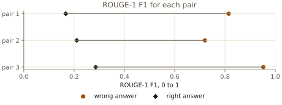

# Write checks in code for the failures you found

By the end of this chapter you can write the format and citation checks that run on every reply at no cost, say which of the failures from [chapter 2](read-the-outputs) each one can and can't see, and show where two standard overlap scores rank a wrong answer above a right one.

[Chapter 2](read-the-outputs) coded 240 dev replies, 80 from each of three variants, and sorted each one by its main defect into seven failure modes. Some of those modes leave a mark in the text of a reply. A citation to a section the prompt never gave is one, and so is an answer to a question the docs don't cover. A program can find both by reading the reply against the item it answers. Other modes leave no mark a program can read. An answer can be right about one version and wrong about another while its citation is correct, and nothing in its text says which version it means.

A team that writes checks only for the marks it can see reports a clean run and misses the failures it never looked for. This chapter sorts the checks by what they can see, builds the ones that run in code, and says what each one leaves out. The test set behind every number here has {{out:format-problems-baseline:dev items}} dev items and {{out:format-problems-baseline:held-out items}} held-out items. Only the dev items are read in this chapter. The held-out items appear as counts in one example, and [chapter 10](declining-when-the-docs-dont-say) gives their decline rates.

## What a code check can see {#what-a-code-check-can-see}

A code check reads the reply's text and data the run already holds: the item's own data, which holds its reference answer and the list of sections that support it, the sections the prompt gave, and the docs' section IDs. It gives the same answer on every run, and it costs nothing to run again on a new batch of replies. Those are its strengths. Its limit is that it reads form and membership, never meaning. It can tell whether a reply has a citation, whether the cited ID was in the prompt, and whether the reply is exactly the decline sentence. It can't tell whether the cited section says what the answer says.

Here is chapter 2's list of modes, each with what a code check can see of it.

- **Over-declining.** A check that counts the decline sentence sees the declines that use it. A decline in other words passes as an answer. That is how q-0080 gets past a phrase check, as [chapter 2](read-the-outputs#over-declining) shows.
- **Wrong-version answers.** A check can see whether each citation belongs to the asked version. It can't see whether the claim matches that version's reference.
- **Wrong answers.** Not visible to code. Whether a claim is right takes a reading of the claim against the reference.
- **Missed refusals.** A check can require the decline sentence on every unanswerable item, and `answered-declined-expected` fires on any answer to one, whatever it cites. It depends on the item's label, so an item the docs don't cover but the test set calls answerable gets past it.
- **Incomplete answers.** Not visible to code in this chapter. Whether a reply covers the whole question is for the judge, under the rubric's rules.
- **Citation problems.** Visible in two parts: a citation outside the prompt, and a citation to a section the item doesn't list. The second part needs a reader, as [the support section](#citation-support) explains.
- **Malformed replies.** Partly. Empty replies, declines with text, uncited answers and replies whose parts come out in the wrong order can be found. The order check in the next section finds the last kind.

A program can also do a judge's work when the rule it applies can be written down. In the preprint [*Can Programs Replace LLM Judges?*](https://arxiv.org/abs/2611.24849) (arXiv 2611.24849, v1, read on 21 November 2026), Agichtein and colleagues have a frontier model turn relevance guidelines into one program per topic, for a task this book leaves to other books: labelling which documents answer a search. The authors report that on TREC DL 2019 to 2021 these programs agree with the NIST assessors at the level of Claude Sonnet 5.5 used as a judge. A program like that is written once, gives the same answer on every run and can be read line by line, which are the strengths this section claims for a code check.

**Working rule:** Write a code check for a failure only when the reply, the item or the run already holds the fact the check needs. For a failure whose evidence is the claim itself, send it to a judge with a written rubric, as [chapter 5](a-judge-with-a-rubric) does, and keep the code check for the parts of the failure that can be read.

## Format checks {#format-checks}

The format check asks whether a reply has the shape the prompt asks for, before anyone reads what it says. The function `format_problems` in `lib/contract.py` returns a sorted list of fixed names, one for each defect it finds. There are five. `empty` is a reply with no text. `declined-with-text` is a reply that contains the decline sentence along with other text. `no-citation` is an answer that cites nothing. [`unknown-section`](#citations-in-code) is a citation to a section the prompt didn't give. `answered-declined-expected` is an answer to an item that has to be declined. A second function, `order_problems`, reads the order of a reply's lines and returns two names: `citation-first`, for a reply whose first line opens with a citation, and `stray-line`, for a line that ends no sentence once its citations are taken out.

The format check reads the reply, the list of sections the prompt gave, and whether the item is unanswerable. The order check reads only the reply's lines. Neither reads what the answer says, so a correct answer and a wrong one with the same shape pass alike.

Run the format check on the baseline's reply to each item, and count each name, with the dev items and the held-out items kept apart.

[Example: format-problems-baseline](../examples/format-problems-baseline.py)

The baseline has no format problem on the dev items, {{out:format-problems-baseline:dev items with a format problem}}, or on the held-out items, {{out:format-problems-baseline:held-out items with a format problem}}. A zero counts only if the check could have fired, and the next example shows that these checks do fire, on other recordings.

[Example: format-problems-variants](../examples/format-problems-variants.py)

The unfiltered variant answers q-0018 and q-0039, which are unanswerable, so `answered-declined-expected` counts them: {{out:format-problems-variants:unfiltered answered-declined-expected}}. The second model's replies carry more problems. Their no-citation count is {{out:format-problems-variants:second-model no-citation}}.

The order check flags the second model's reply to q-0030. That reply opens with its citation, so it is `citation-first`: {{out:format-problems-variants:second-model citation-first}}. Its first line also holds a fragment of a heading, which is a `stray-line`. A reply whose last line ends no sentence gets that name too, and one of the two is q-0007, whose text is cut off in the middle of a repeated sentence: {{out:format-problems-variants:second-model stray-line}}.

The format check passes that q-0030 reply. `format_problems` counts citations and doesn't read where they fall, so a reply can cite only sections the prompt gave and still have its parts out of order. That gap is what the order check is for. The example also runs one fixture reply for each name, and it stops if a name does not fire, so each zero above means the check looked and found nothing.

A check that never fires on the baseline still earns its place, because it costs nothing and catches the next prompt that breaks a shape.

**Working rule:** Run the format check and the order check on every reply before a judge reads it, and report each name's count on each split. A zero counts as a result only when the check could have fired, so keep the fixture run with the report. When a count rises, read the replies behind it before you change the check, because a name says which shape broke and not why it broke.

## Citation checks {#citation-checks}

[Chapter 1](measure-before-you-change#citations-in-code) wrote the first citation check: every ID a reply cites must be one the prompt gave. That check says whether a citation is inside the prompt. It doesn't say whether the citation is the right one for the item. This section asks two more questions of each cited ID. Does it exist in the docs for the version the item asks about? And is it a section the item lists as supporting the answer?

`citation_outcome` gives each cited ID one of four outcomes. `supported` means the ID is on the item's list for the asked version. `unlisted` means a section of the asked version that the item doesn't list. `wrong-version` means a section that exists in another version only. `missing` means no version has a section with the cited ID. Two rules apply to all four. A reply carries IDs and not versions, so an ID that appears in two versions can't be wrong-version, and it's judged against the version asked. And `unlisted` is never called wrong. The item's list was written by hand, and a section it doesn't list may still support the answer.

The check runs over the dev items for three recordings: the baseline; the unfiltered variant, which uses the same prompt but retrieves from every version and shows the versions to the model; and prompt-b, chapter 1's quote-first prompt P2 ([two prompts](measure-before-you-change#two-prompts)), which asks the model to quote first the sentence its answer relies on and cites on each line. Its {{out:check-citation-support:prompt-b citations on dev items}} citations come from the same items, so its shares are per citation. Each recording's citations are sorted the same way.

[Example: check-citation-support](../examples/check-citation-support.py)

Most citations in every recording point at a section the item lists. The listed share is {{out:check-citation-support:baseline supported}} for the baseline, {{out:check-citation-support:unfiltered supported}} for the unfiltered variant, and {{out:check-citation-support:prompt-b supported}} for prompt-b.

### Existence and version {#citation-existence}

The version check finds nothing in these recordings. A wrong-version citation, as defined above, is one to a section of another version only. For the baseline, the wrong-version share is {{out:check-citation-support:baseline wrong-version}}. For the unfiltered variant, it is {{out:check-citation-support:unfiltered wrong-version}}. For prompt-b, it is {{out:check-citation-support:prompt-b wrong-version}}. The missing outcome is absent from all three recordings too. That is a statement about citations only. It doesn't show that the assistant answers every question for the version asked.

The unfiltered variant is the one to watch, because its context holds the sections of every version. If any recording cited the wrong version, it would be this one. It cites none. The errors that matter sit in the claims. [Chapter 2](read-the-outputs#wrong-version-answers) codes the baseline's reply to q-0023 as a wrong-version answer. It gives the 2.0 result for an ignore entry in 1.0, and it cites a section of 1.0. The citation is in the asked version, so this check passes it. The claim has to be read against the 1.0 reference before the error shows.

**Working rule:** Report the wrong-version and missing outcomes as their own rates, and never let a zero there stand for a right answer. For each version-dependent item, read the claim against the reference for the version asked. [Grounded answers](grounded-answers) builds that reading into a rate of its own.

### Support {#citation-support}

The unlisted outcome is where this check does its work, and it needs a reader. A citation to an unlisted section of the asked version is not an error under this check's rules, because the item's list was written by hand and may be incomplete. The baseline's reply to q-0057 is a case in point: it cites `remote-retries`, which the item doesn't list. The code sorts that citation as unlisted, and [chapter 2](read-the-outputs) codes the reply as a citation problem, so it takes a reader to decide the citation is a problem. Chapter 2 also states the candidate as a rule that every citation must be one the item lists. This chapter loosens that rule, because the list is hand-written and a reader, not the list, decides.

The unlisted shares are {{out:check-citation-support:baseline unlisted}} for the baseline, {{out:check-citation-support:unfiltered unlisted}} for the unfiltered variant, and {{out:check-citation-support:prompt-b unlisted}} for prompt-b. The unfiltered variant has the highest unlisted share. Each of its unlisted citations is a question for a reader: does this section support the sentence it is cited for?

A `supported` outcome means only that the ID is on the list. A listed section can still fail to support the sentence it's cited for, because this check reads IDs and not sentences. Whether a listed section supports its sentence is a judgement, and this check does not make it. [Grounded answers](grounded-answers) reuses the four outcomes defined here as its citation accuracy, which also reads IDs only, and adds an answer-level faithfulness judge, written as [a judge with a rubric](a-judge-with-a-rubric) describes.

**Working rule:** Count a citation as supported only when its ID is on the item's list, and never as correct. Read each unlisted citation against its section before you call it a problem. Report unlisted apart from wrong-version and missing, because a fuller list would move some of the unlisted citations to supported.

## Exact and fuzzy match {#exact-and-fuzzy}

Most string checks in this book use one of two comparisons. An exact match asks whether two strings are equal, and it suits any text that is fixed. [Chapter 1](measure-before-you-change#declines-in-code)'s decline check is one. A reply counts as a decline only when its whole text equals the decline sentence, which is what the `declined` field of a parsed reply holds. A section ID, a flag name and a file name are fixed in the same way. An exact match gives a yes or a no, and it never returns a near miss.

A fuzzy match scores how alike two strings are. Python's standard library difflib does this. Its `SequenceMatcher` class gives the score as `ratio()`, which the documentation defines as twice the number of matching elements divided by the total number of elements in both sequences. Three things about that score matter for a check.

- It depends on argument order. The documentation warns that the result of a `ratio()` call may depend on the order of the arguments, so a check has to pass the reference in the same position every time. On the long pair in the example, the score is {{out:fuzzy-match:long answer, ratio}} with the reference first and {{out:fuzzy-match:long answer, ratio with the reply first}} with the reply first.
- It counts matches, not meaning. A one-letter typo in a flag scores {{out:fuzzy-match:flag, ratio}} against the right flag, although the flag is wrong. A reply can keep a high score while its one wrong fact changes.
- It can skip parts of long strings. For sequences of 200 items or more, the documentation treats an item as junk when its repeats make up more than one per cent of the sequence, unless `autojunk` is turned off. For strings, the items are characters, so a reply of 200 characters or more can be affected. The heuristic is built from the second argument, which is the reply when the reference goes first. On the long pair, the default score is {{out:fuzzy-match:long answer, ratio}}, and with `autojunk=False` it is {{out:fuzzy-match:long answer, ratio with autojunk off}}.

[Example: fuzzy-match](../examples/fuzzy-match.py)

The three pairs are written for this example, so the scores show what each property does, not how often a reply breaks it.

**Working rule:** Use an exact match wherever the expected text is fixed. Use a fuzzy ratio only to order replies for reading, never as a pass or a fail, until a recorded run shows where a threshold should sit for this book's answers. When you call `ratio()`, pass the reference first every time, and say in the check's docstring which string is which.

## Where BLEU and ROUGE mislead {#where-bleu-rouge-mislead}

Two word-overlap scores borrowed from other tasks can be used to check generated text. BLEU came from machine translation and ROUGE from summarisation. Both are cheap to compute.

Papineni and colleagues proposed BLEU in 2002 as a quick and inexpensive way to score machine translation, from modified n-gram precision and a brevity penalty ([Papineni and colleagues, 2002](https://aclanthology.org/P02-1040.pdf)). Reiter's review of how well BLEU tracks human judgement found that the evidence supports it for diagnostic evaluation of machine translation systems. It does not support BLEU outside machine translation, for evaluation of individual texts, or for hypothesis testing ([Reiter, 2018](https://aclanthology.org/J18-3002.pdf)). A score that holds for systems doesn't thereby hold for one answer.

Lin defined ROUGE-N as an n-gram recall: the share of the reference's word runs that the candidate covers ([Lin, 2004](https://aclanthology.org/W04-1013.pdf)). That paper is about summaries. A separate study tested metrics borrowed from machine translation on dialogue responses, not on documentation answers. It found they correlate very weakly with human judgement on a general chat data set, and not at all on a technical one, the Ubuntu help data ([Liu and colleagues, 2016](https://arxiv.org/pdf/1603.08023)). That is one study of one task. Sablefile's answers are technical, so the result is a warning, not a measurement of this assistant.

Three questions about sablefile 2.0 show the problem most plainly. Each has a written reference answer, a wrong answer that copies most of the reference's words, and a right answer that says the same thing in few of them. The answers are written for this example, not taken from a recording, so they show that the failure can happen, not how often. The BLEU-style score takes clipped 1- to 4-gram precision, its geometric mean and a brevity penalty. ROUGE-1 F1 counts the single words a candidate shares with its reference, as an F1. Both formulas are written out in the example's code. No BLEU or ROUGE package is pinned in this book, and the example reports F1, the harmonic mean of recall and precision, not the recall Lin defined.

[Example: overlap-misleads](../examples/overlap-misleads.py)

The wrong answer outscores the right one on ROUGE-1 F1 in {{out:overlap-misleads:pairs where the wrong answer has the higher ROUGE-1 F1}} pairs. For pair one, the wrong answer scores {{out:overlap-misleads:pair 1, wrong answer, ROUGE-1 F1}}, and the right answer scores {{out:overlap-misleads:pair 1, right answer, ROUGE-1 F1}}.

Read the BLEU lines with care. The formula the code writes out has no smoothing, so the score is zero whenever any of the four n-gram orders has no match at all. Each right answer shares single words with its reference but no two-word run, so its two-word precision is zero, and so is its BLEU. That is the formula's behaviour, and it says nothing about whether the answer is good.

{{fig:overlap-wrong-right}} draws each pair as a row of ROUGE-1 F1 scores, one marker for the wrong answer and one for the right, named in the legend. In every pair the wrong answer scores higher, and its smallest lead over the right answer is {{out:figure-overlap-wrong-right:smallest wrong-minus-right gap, ROUGE-1 F1}}.

[Example: figure-overlap-wrong-right](../examples/figure-overlap-wrong-right.py)

ROUGE-1 F1 counts single words and ignores their order. A wrong answer that repeats most of the reference's words gets most of the score back, whatever words it gets wrong. Pair three shows it. Its wrong answer scores {{out:overlap-misleads:pair 3, wrong answer, ROUGE-1 F1}}. That answer names the file from version 1.1, where the reference names `.sablefile/lock.json`. Every word of the wrong answer appears in the reference, and the only reference word it lacks is `json`. The file name is the part of the answer that matters, and the score can't tell that part from the rest.

**Working rule:** Don't use BLEU or ROUGE as the pass mark for an answer with one right form. If you report them, name the formula and say whether it is smoothed. Read every answer whose overlap is high and whose claim is in doubt, since the pairs above show that overlap rewards a wrong answer that copies the reference. Check the claim with a judge, as [chapter 5](a-judge-with-a-rubric) describes.

## Declines in code {#decline-checks}

[Chapter 1](measure-before-you-change#declines-in-code) already has a code check for declines. It counts two errors against the exact decline sentence: an answerable item the assistant declined, and an unanswerable item it answered. This chapter's format check adds one shape, the decline sentence with other text in the same reply, and it runs the unanswerable-item check on every item of both splits, where chapter 1 ran it on twenty. The format counts for the baseline are zero on both splits, as [format checks](#format-checks) shows. On chapter 1's twenty items the decline check found neither error. This chapter doesn't rerun it on the dev items. [Chapter 10](declining-when-the-docs-dont-say) gives the baseline's false refusal rate over them.

Both checks read the reply's text, and both have a limit that follows from it. A decline in other words isn't the sentence, so it passes as an answer, as q-0080 shows in [chapter 2](read-the-outputs#over-declining). The decline rates also leave out version-dependent items, and item q-0004 shows what that costs, as [chapter 1](measure-before-you-change#declines-in-code) explains. The baseline declines it, and the 2.0 docs answer it in their placeholders section. The decline rate doesn't count that as a false refusal. [Grounded answers](grounded-answers) builds the version-correctness rate that does.

Whether a decline is right on an item the docs don't cover is a judgement, not a code check. Whether the docs say enough to answer is the question that [declining when the docs don't say](declining-when-the-docs-dont-say) takes up.

**Working rule:** Count both decline errors on every split, and read each version-dependent decline against the docs for its version by hand, because the decline rate leaves those items out.

## Running the checks, and what they settle {#running-the-checks}

In production the checks run on every reply, so a change to the prompt or the model moves the format counts, the decline rates and the unlisted share in one report. A change that leaves all of them flat while users report wrong answers is the signal that the checks don't see the failure. Code the new replies by their main defect, as [chapter 2](read-the-outputs#from-a-failure-to-a-check) describes, and write a check for the mode that fits.

What the chapter establishes is narrow. A code check can keep a reply's shape, its citations' membership and the decline sentence honest, and it can say so on every reply at no cost. What a reply means still needs a reader or a judge. So code each reply by its main defect, keep every check to the defects it can see, and send what it can't see to a reader or a judge, so that a clean count is never taken for a clean answer.

The chapter made these decisions:

- The format check is a guard with five names, run before any judge.
- The format check counts citations and doesn't read their order, so it passes the second model's reply to q-0030. The order check flags that reply.
- A citation is `supported` when its ID is on the item's list, and never when the sentence around it is right.
- The version check on citations finds no wrong-version citation in these three recordings, and the chapter doesn't present that as a check on the answers' versions.
- The overlap scores come from the example's own formulas, and no score is used as a pass mark.
- The fuzzy-match properties are shown on sablefile answers, and no ratio is used as a pass mark.
- Held-out items appear only as counts in the format check, and [chapter 10](declining-when-the-docs-dont-say) reads them.
