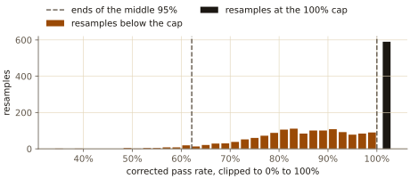

# Measure a judge's errors against human ratings, then correct a pass rate

By the end of this chapter you can measure how a judge's verdicts differ from human ratings, split those differences into misses and false passes, and correct an observed pass rate for them, with the assumption the correction rests on written beside it.

[Chapter 5](a-judge-with-a-rubric) ended with a second wording of the calibration task, and with the rule that a judge's wording is measured, not assumed. The answer judge reads each reply against a written reference and marks it PASS or FAIL, and the baseline run of the assistant gets its pass rate from that judge. The rate is a number about the judge as much as about the assistant, because a judge can pass a wrong reply or fail a right one. [Chapter 5](a-judge-with-a-rubric) wrote the rubric and read the verdicts. This chapter asks how often those verdicts are wrong, in which direction, and what a team does to a rate once it knows.

## Human ratings, and what they are {#human-ratings}

A judge can only be checked against labels that were made some other way. This book uses human ratings from [HelpSteer2](https://huggingface.co/datasets/nvidia/HelpSteer2), a public dataset from NVIDIA. Each row holds a prompt, one response to it, and five attribute scores from 0 to 4, given by people. The responses come from other models. This chapter uses one attribute, correctness. The sampling code turns the score into pass or fail: a score of 3 or 4 is read as PASS, and a score of 0 to 2 as FAIL. That cut is the book's choice, made before any judge was run.

HelpSteer2 is not the book's own data. Its responses come from other models, its prompts are general, and nobody wrote them for sablefile. So these labels measure how the judge does on a different question from the one the answer judge answers. That gap is the subject of [the transfer assumption](#transfer-assumption), and the rest of the chapter keeps returning to it.

The calibration judge reads with a rubric written for that one attribute. It asks whether every fact and result in a reply is right, and it tells the judge to set aside length, tone, style and formatting, as [chapter 5](a-judge-with-a-rubric#what-a-judge-is-asked) describes. The book's own test set could serve as the calibration, but the book has no human ratings of sablefile's replies. So the calibration uses public rows instead, and pays for that with the transfer assumption. The dataset does not hand the book a pass line for correctness. The book sets the line itself, and every rate in this chapter is read against it. A different line would move every rate, so a reader who compares this chapter with another study should first check where that study put its line.

The calibration rows are a sample of the dataset's validation split, drawn with a fixed seed. Rows whose text held characters outside printable ASCII were dropped before the draw. The draw takes about 45 FAIL and 45 PASS rows from each split, and it keeps one row per prompt. The base rate is therefore set by the sampling, not found in the dataset. The sample is split into dev and held-out. The same dataset also holds pairs of responses to one prompt, with a human preference between them. Pairs whose preference strength is zero are left out.

The split decides how the numbers may be used. Dev is where the book sets anything, including the rates a correction uses. Held-out is read once, in this chapter, after everything else is fixed, and nothing here is chosen with it. The held-out figures were first computed at the recording check, before this chapter was written. They are reported here as they stood, not recomputed to choose anything.

**Working rule:** Calibrate against labels made for the question the judge answers, or say in the text how far they are from it. Write down the rule that turns a score into the judge's pass or fail before you look at any result. Keep the split you tune on apart from the one you report once.

## Agreement and kappa {#agreement-and-kappa}

Agreement is the share of rows on which the judge and the human give the same verdict. It can mislead when one verdict dominates. A judge that passes everything agrees well with a sample that is mostly PASS, and agreement alone cannot tell that judge from a careful one. The fix is to ask what agreement the two verdicts would reach by chance, from their two PASS rates alone, and then take the chance out. Kappa does that. For two raters on pass or fail, kappa is the observed agreement minus the chance agreement, divided by one minus the chance agreement. [The kappa statistic, a review by McHugh](https://hrcak.srce.hr/file/132393), gives that formula. Kappa is one when the two raters agree on every row.

[Example: calibration-agreement](../examples/calibration-agreement.py)

Agreement on all rows is {{out:calibration-agreement:agreement, all}}. Chance agreement, from the two PASS rates alone, is {{out:calibration-agreement:chance agreement, all}}. Kappa is {{out:calibration-agreement:kappa, all}}, with two decimals and no percent sign, because it is a statistic on its own scale, not a rate. Agreement and chance agreement are both percentages, so they can be compared directly. Kappa is the figure that already has the chance taken out, so it is the one to read as the judge's agreement beyond chance.

Kappa runs from −1 to 1. It is 0 at chance agreement, and it is negative when the two raters agree less often than chance would, as [McHugh's review](https://hrcak.srce.hr/file/132393) notes.

Read the three figures in order: agreement, then the chance figure beside it, then kappa. If agreement rises while chance rises with it, the gain may come from the base rate rather than from the judge.

The two splits read the same way. On dev, agreement is {{out:calibration-agreement:agreement, dev}}. Kappa on dev is {{out:calibration-agreement:kappa, dev}}. On held-out, agreement is {{out:calibration-agreement:agreement, held-out}}, and kappa is {{out:calibration-agreement:kappa, held-out}}.

The base rate is the reason kappa matters. When one verdict dominates the rows, chance agreement is high, and a judge can post a high agreement while telling the two verdicts apart badly. Here the draw holds about as many PASS rows as FAIL rows, so chance agreement sits near half. The human PASS rate on dev is {{out:rubric-b-agreement:human PASS rate, rubric A, dev}}. A team with a lopsided sample should expect chance agreement to sit near its agreement, so kappa is near zero even when agreement looks high. It should read kappa first.

Agreement measures closeness to the human labels, not whether the replies are right. High agreement says the judge's verdicts match the people's, not that the assistant's replies are right. Kappa tells you how far the agreement is from chance, but not which way the judge errs. That needs the next two rates.

Chapter 5 described a second calibration wording, rubric B. The calibration rubric, rubric A from here on, says that a reply which makes no false claim is "not incorrect". Rubric B rewords it: it says "right" where A says "not incorrect", and it drops the points about misleading and confidence. Rubric B was recorded on dev only. The next example sets the two wordings side by side on the same dev rows.

[Example: rubric-b-agreement](../examples/rubric-b-agreement.py)

No difference shown on dev. Agreement under rubric B is {{out:rubric-b-agreement:agreement, rubric B, dev}}. Under rubric A, on the same rows, it is {{out:rubric-b-agreement:agreement, rubric A, dev}}. The paired difference is {{out:rubric-b-agreement:paired difference, dev}}. For each dev row, the code scores 1 when a wording agrees with the humans and 0 when it does not. The paired difference is rubric B's score minus rubric A's, averaged over the dev rows, and its interval is bootstrapped over those rows. The example's reading of that interval is {{out:rubric-b-agreement:paired difference, dev, reading}}.

The interval includes zero, so the dev estimate does not show that rubric B is better. Rubric B has no held-out run, so its dev estimate has no second check. Its unreadable replies are {{out:rubric-b-agreement:unreadable, rubric B}}, so no reply was left out.

**Working rule:** Report agreement beside kappa, and read kappa against the chance figure printed next to it. Name the rubric and the split with every number, so two wordings are never read as one. Call one wording better only when the lower bound of its paired interval is above zero, and only on held-out, or on dev with that caveat beside the claim. When the interval spans zero, say that no difference was detected at the n you have, and do not turn a higher point estimate into a claim.

## True positive and true negative rates {#tpr-and-tnr}

Agreement and kappa say how often the judge agrees with the humans. They do not say which way it errs. The two rates that do are the true positive rate and the true negative rate. The true positive rate, TPR, is the share of human PASS rows that the judge passes. The true negative rate, TNR, is the share of human FAIL rows that the judge fails. A judge that passes too much has a high TPR and a low TNR, because its errors are false passes. A judge that fails too much is the reverse. The correction in the next section needs both rates, since each one fixes a different error.

[Example: tpr-tnr](../examples/tpr-tnr.py)

Here PASS is the positive class, so TPR is taken over the human PASS rows and TNR over the human FAIL rows. Each rate prints its counts beside it, so a reader can see how many rows it rests on.

On all rows, TPR is {{out:tpr-tnr:TPR, all}}. TNR is {{out:tpr-tnr:TNR, all}}. The judge passes most of the replies that humans passed, and it also passes a fair share of the replies humans failed. The weaker of the two rates is TNR, which makes this judge lenient.

The direction matters for anyone who reads a pass rate, and it depends on where the rate sits. The pass-rate correction in the next section leaves a rate unchanged at the crossover point, p* = (1 − TNR) / (2 − TPR − TNR). Below p* the correction lowers the rate, and above p* it raises the rate. For a lenient judge, p* sits high, so a reported rate below it reads too high and a rate above it reads too low. On dev, the crossover point is {{out:corrected-pass-rate:crossover point, dev}}. Knowing where a rate sits against that point tells a team which way its reported number leans, before any correction is applied. Agreement alone would hide this. Two judges can agree with the humans to the same degree and still differ in which error they make more often, and the rates they report would differ with it.

On dev, TPR is {{out:tpr-tnr:TPR, dev}}, and TNR is {{out:tpr-tnr:TNR, dev}}. On held-out, TPR is {{out:tpr-tnr:TPR, held-out}}, and TNR is {{out:tpr-tnr:TNR, held-out}}. The held-out split lands close to dev on both rates, with TNR a few points lower.

Each rate is taken over one group of human labels, and each split has few enough rows that another sample could move the rates. This chapter prints no interval for TPR or TNR. Read the rates as the judge's error on this sample, not as its error in general.

**Working rule:** Report TPR and TNR together, with their counts, and say which way the judge errs. Take the rates a correction uses from dev alone, and quote both beside any corrected rate. Report held-out once, after the choices are made, and keep it out of every choice.

## Correcting a pass rate {#correcting-a-pass-rate}

The observed pass rate counts two kinds of verdict: true passes the judge caught, and false passes it let through. The correction tries to undo both at once. Given the judge's TPR and TNR, it solves for the true share of passes that would produce the observed rate. The book writes it as (observed + TNR - 1) / (TPR + TNR - 1). [Rogan and Gladen](https://doi.org/10.1093/oxfordjournals.aje.a112510) (1978) address the same problem for screening tests, and their abstract says that adjustments of this kind are given. The book has read only that abstract, so the formula here is the book's own statement of the correction, as its code computes it, and not a quotation from the paper.

The correction has a limit. It divides by TPR + TNR - 1. A judge whose two rates sit near what chance would give has a denominator near zero, and then small errors in either rate become large swings in the corrected rate. The book's code refuses to correct when that denominator is below 0.1, and it raises an error instead of printing a rate. The run below stays well clear of that floor. In practice a team does four things in order: measure TPR and TNR on a calibration set kept apart from the set it will correct, check that the denominator clears the floor, apply the correction to the observed rate over the readable replies, and write the transfer assumption beside the result.

[Example: corrected-pass-rate](../examples/corrected-pass-rate.py)

The input is the baseline's answer-judge verdicts for the test items, all 120 of them, dev and held-out together. One reply had no readable verdict, because its first line was not PASS or FAIL. The example prints it by name and leaves it out of the rate, since a reply the judge could not read is not a FAIL. [Chapter 5](a-judge-with-a-rubric#verdict-first) explains the two ways the code reads an unreadable verdict. The line for it reads {{out:corrected-pass-rate:unreadable verdicts}}. [Chapter 1](measure-before-you-change#a-pass-rate-and-its-interval) defines the pass rate over every item in the set. This rate is over the readable items, so it departs from that definition by the one reply left out.

The observed pass rate over the readable items is {{out:corrected-pass-rate:observed pass rate, readable items}}. The correction uses TPR and TNR from dev, and those are the only rows it may use. Its TPR on dev is {{out:corrected-pass-rate:TPR, dev}}. Its TNR on dev is {{out:corrected-pass-rate:TNR, dev}}.

The corrected rate is {{out:corrected-pass-rate:corrected pass rate}}. The corrected rate estimates the share of sablefile's replies that a person would pass, under the book's correctness cut. It is not the judge's pass rate, which is the observed rate above, and it is not the assistant's accuracy. The estimate holds only if the judge's errors on sablefile's answers match its errors on HelpSteer2 rows. That is the [transfer assumption](#transfer-assumption), and the TPR and TNR above come from a reference-free judge rating other models' responses, while the answer judge checks sablefile's replies against a reference.

The corrected rate is higher than the observed rate, and the crossover point shows why. The observed rate sits above the crossover point, where the judge reads low. At that rate the judge's misses on true passes outweigh its false passes, so the correction raises it.

The result is also close to the code's ceiling. The code clips the corrected rate to the range from 0 to 1. The unclipped value passes 1 exactly when the observed rate is above TPR, because then the numerator is larger than the denominator. Here the observed rate sits under TPR by less than four points. If two of the dev PASS rows the judge passed had been failed instead, TPR would fall below the observed rate, and the corrected rate would print 100.0%.

**Working rule:** Correct a pass rate only with TPR and TNR measured on a calibration set. Quote both beside the corrected rate, refuse when the denominator is small, and say in the same paragraph what the correction assumes. The next section gives the interval and the one-row moves that go beside any corrected rate.

## How much one row moves the corrected rate {#how-much-one-row-moves-it}

[Example: correction-sensitivity](../examples/correction-sensitivity.py)

The example resamples both the dev rows and the readable items, 2,000 times, with the book's fixed seed, and it reads the spread of the corrected rate. The 95% interval is {{out:correction-sensitivity:corrected pass rate, 95% interval}}. It is wide, because TPR and TNR each rest on a few dozen dev rows, and its upper end is the cap itself. Some resamples reach the cap. Their share is {{out:correction-sensitivity:resamples at the 100% cap}}. Resamples refused for a denominator under 0.1 are {{out:correction-sensitivity:resamples refused, TPR + TNR - 1 below 0.1}}, and the interval is taken over the rest.

[Example: figure-corrected-resamples](../examples/figure-corrected-resamples.py)

{{fig:corrected-resamples}} shows those resamples as bars. The bar at the cap, drawn beside the 100% line, is taller than any bin below it. The bins below the cap are {{out:figure-corrected-resamples:bin width below the cap, in points}} points wide, and the fullest one holds {{out:figure-corrected-resamples:resamples in the fullest bin below the cap}} resamples.

The one-row moves are these. If one dev row that humans passed had been judged PASS rather than FAIL, TPR would be one row higher, and the corrected rate would be {{out:correction-sensitivity:corrected, TPR one row higher}}. If one such row had been judged FAIL, TPR would be one row lower, and the corrected rate would be {{out:correction-sensitivity:corrected, TPR one row lower}}. For TNR, one dev row that humans failed and the judge passed would change the rate to {{out:correction-sensitivity:corrected, TNR one row higher}} if it were judged FAIL, and to {{out:correction-sensitivity:corrected, TNR one row lower}} if it were judged PASS. TPR is the rate to watch: one row there moves the answer by four to five points, while one row of TNR moves it by about half a point.

The interval covers the sampling of the dev rows and the readable items. It does not cover the transfer assumption. A judge whose errors differ on sablefile's replies could move the rate by more than the resamples show.

**Working rule:** Give the corrected rate with the bootstrap interval the book uses for its rates, the share of resamples at the cap, and the one-row moves beside it, so a reader can see how far single rows matter.

## The transfer assumption {#transfer-assumption}

The TPR and TNR above come from rows where the judge read other models' responses with no reference, under the correctness rubric, and the PASS line there is HelpSteer2 correctness of 3 or more. The answer judge reads sablefile's replies against a written reference, and a PASS there means the reply agrees with the reference, with a correct decline counting as a pass. The two judges answer different questions about what right means. The transfer assumption is that the judge's miss rate on human passes, and its pass-through rate on human fails, are the same on sablefile's replies as on the HelpSteer2 rows. Nothing in this chapter tests that. The correction holds only if the differences in input, replies, questions and PASS criterion leave the error profile unchanged. [Chapter 5](a-judge-with-a-rubric#reference-guided) sets out the difference between a judge with a reference and one without.

The last lines of the same example apply the correction to the calibration rows, with rates taken from those rows. On those rows, the judge's PASS rate is {{out:corrected-pass-rate:calibration set, judge PASS rate}}. Its crossover point is {{out:corrected-pass-rate:crossover point, calibration set}}, and the judge's rate sits below it, so the correction lowers the rate. The corrected judge PASS rate is {{out:corrected-pass-rate:calibration set, corrected judge PASS rate}}. The human PASS rate is {{out:corrected-pass-rate:calibration set, human PASS rate}}.

The corrected judge rate returns the human rate. That follows from the algebra, because the rates were measured on those same rows. The check confirms that the arithmetic is right. It says nothing about whether the correction applies to sablefile, and a reader should not take it as evidence for the transfer.

The better fix is labels on the book's own replies. The book has none, because no person has rated sablefile's replies. A reader with such labels should calibrate on them, keeping a split apart from the set being corrected, as this chapter keeps dev apart from held-out. That would remove most of the transfer assumption, where the public rows only pay for it.

**Working rule:** Write the transfer assumption beside every corrected rate, in the same paragraph, and name the difference between the calibration judge and the judge the rate describes. Check the arithmetic on the rows the rates came from, and say that such a check does not test transfer. Until human labels on the answers the rate describes exist and have been checked against the judge, call the corrected rate an estimate that holds if the assumption does.

## Pairwise calibration {#pairwise-calibration}

A pairwise judge reads two replies and picks the better one, rather than passing or failing each. The human side is the HelpSteer2 preference between the two responses to a prompt. A pairwise judge has a known weakness: which reply sits in position A and which in B can decide the pick. [Chapter 5](a-judge-with-a-rubric#one-answer-or-two) explains why the book asks the judge about each pair in both orders, and [chapter 7](when-the-judge-stops-being-reliable#position) analyses the order changes that position causes. This section asks what agreement with the human preference looks like when both orders are counted. The order-changed count it prints is the one chapter 5 printed, and it is shown here only to explain the gap.

Each pair is a HelpSteer2 prompt with two responses and a human preference between them. Pairs with a tie were dropped, so every pair has a human pick. A TIE from the judge is a miss, because the judge said the two replies were equal when the human chose one. A single order gives a rate that depends on which letter the judge favoured, so a team that reports one order reports a number that the position of the replies can move. Counting both orders removes that freedom at the cost of a lower number. We recommend reporting the stricter rate for a pairwise judge, and reading the single-order rates only as a diagnostic of the gap between them.

Before you run the example, predict whether a pair that counts only when both orders pick the human's response will score above or below either order taken alone. Then check the guess against the output.

[Example: pairwise-agreement](../examples/pairwise-agreement.py)

Counted in both orders, agreement is lower than in either order alone, and the gap comes from the order-changed pairs. On dev, the A,B order alone gives {{out:pairwise-agreement:agreement, A,B order, dev}}. The B,A order alone gives {{out:pairwise-agreement:agreement, B,A order, dev}}. Counting both orders gives the stricter rate, {{out:pairwise-agreement:agreement, both orders, dev}}.

The count after the semicolon is the order-changed pairs, which the example's output labels flipped. An order-changed pair, as [chapter 5](a-judge-with-a-rubric#one-answer-or-two) defines it, is one where the verdict followed the position and not the reply. An order-changed pair can never count in the both-orders rate, so each one is a miss there.

The held-out split shows the same pattern. The A,B order gives {{out:pairwise-agreement:agreement, A,B order, held-out}}, the B,A order gives {{out:pairwise-agreement:agreement, B,A order, held-out}}, and both orders give {{out:pairwise-agreement:agreement, both orders, held-out}}.

The interval on the both-orders rate, over pairs, is {{out:pairwise-agreement:95% interval, both orders, dev}} on dev. On held-out it is {{out:pairwise-agreement:95% interval, both orders, held-out}}. These intervals are wide because each split has few pairs. The reading that holds is the pattern: a judge that changes its pick with position cannot be read as agreeing with people in any single order.

After this chapter the reader can measure a judge's agreement beyond chance, its misses and false passes on this sample, and a corrected pass rate with its transfer assumption written beside it. Those measures rest on public rows, not on sablefile's replies, and a pairwise judge counted in both orders still loses pairs to position. [Chapter 7](when-the-judge-stops-being-reliable) tests the limits a judge can show on the book's own recordings, starting with position, and it is where a reader learns when to stop trusting a verdict.

**Working rule:** When a judge compares two replies, run it in both orders, and report agreement counted both ways with the order-changed pairs beside it. Never read a single-order rate as the judge's agreement with people. Report the interval over pairs, and say that an order-changed pair is a miss, because it is the cost of position.
