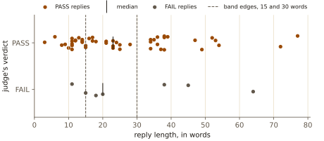

# Find where a judge's verdict stops being reliable

By the end of this chapter you can test a judge for two biases that this book's data can show, position and length. You can say what each test shows and what it leaves open, and you can write down the conditions under which you stop trusting one of its verdicts.

[Chapter 6](calibrate-the-judge) measured the judge's errors against human ratings, and it ended by asking what a pairwise judge does when its two replies trade places. This chapter asks what else can move a verdict in the sablefile replies the judge grades. The judge reads a reply to a test question, sets it against the reference answer, and prints PASS or FAIL, as [Chapter 5](a-judge-with-a-rubric) sets up. Its pass rate is the number a team would report, and that number is worth reporting only if the verdict depends on the reply. A verdict that changes when two answers trade places, or a pass rate that climbs with the length of a reply that says no more, measures something other than the answer. A rate built on such a verdict can look like progress without being any.

Two cautions hold for the whole chapter, so they are said once, here. The judge is Qwen3-4B-Instruct-2507, and every rate in this chapter is measured on that model. The published figures the chapter cites come from other judges, and they show what can happen to a judge, not what this judge does. The second caution is size. The human-rated pairs and the dev items are small sets, so every rate comes with its count, and every comparison comes with an interval.

The chapter takes three limits in turn. The first is position: whether a pairwise verdict depends on which answer was shown first. The second is length: whether the pass rate rises with the length of the reply. The third is self-preference: whether the judge favours answers written by its own model. The book can test the first two on its own recordings, because the recordings hold what the tests need: every human-rated pair judged in both orders, and every reply with a length that can be counted. It cannot test the third, and the section on it says why. The last section turns the three limits into rules a reader can apply, each tied to a count.

## Position {#position}

Ask the judge which of two replies is better, and its answer can depend on which reply it read first. A team that reads one order only would not see that dependence, and its report would carry the order along with the answers.

The test is simple to state. Judge each pair twice, once with the replies in one order and once swapped. A verdict that follows the reply it prefers is consistent. A verdict that follows the position changes when the order changes, which means the judge's choice depends on where a reply sat as well as on what it says. A judge can lean toward the first reply it reads or toward the second. The test shows that lean only as order changes. It can't say what causes the lean, and it doesn't need to, because an order-changed verdict is one a reader should not use as it stands. [Chapter 5](a-judge-with-a-rubric) sets up the two orders and the verdicts, and [Chapter 6](calibrate-the-judge) checks the judge's choices against human ratings.

Each human-rated pair is judged in both orders, and each pair lands in one of four kinds: consistent, order-changed, tie or unreadable. The example's output calls the order-changed pairs flipped. An unreadable pair has a missing verdict in either order. For the order-changed pairs, the question is which position won both orders.

[Example: position-flips](../examples/position-flips.py)

Most verdicts hold across the two orders. On dev, {{out:position-flips:consistent, dev}} were consistent and {{out:position-flips:flipped, dev}} changed with the order. On held-out, {{out:position-flips:consistent, held-out}} were consistent and {{out:position-flips:flipped, held-out}} changed with the order.

A tie counts as a readable verdict, so it stays in the denominator of the order-change rate. Here ties came to {{out:position-flips:tie, dev}} on dev, and unreadable verdicts to {{out:position-flips:unreadable, dev}}, so every dev pair gave a verdict in both orders.

Across both splits, the order-change rate is {{out:verdict-limits:order-change rate}}. Its denominator is the pairs read in both orders, so a pair with an unreadable verdict in either order is left out.

The order changes lean toward the second position, and the pooled count is the one to read, because the split counts are small. Over both splits, the first position's share of the order changes is {{out:position-flips:flipped, first position won both orders, both splits}}. Its interval is {{out:position-flips:first-position share interval, both splits}}, and the interval lies entirely below one half. So the pooled count separates the lean from an even split, for these pairs. The pooled share rests on few order changes, so a handful moving either way would shift it by several points. On dev alone the share is {{out:position-flips:flipped, first position won both orders, dev}}, and on held-out it is {{out:position-flips:flipped, first position won both orders, held-out}}.

Other studies have found the lean on other judges, and the leans did not all point the same way. [Wang and colleagues (2023)](https://arxiv.org/abs/2305.17926), a preprint, reported that GPT-4 favoured the first position and ChatGPT the second, in a setup with different models. [Zheng and colleagues (2023)](https://arxiv.org/abs/2306.05685), at the NeurIPS 2023 Datasets and Benchmarks track, reported that GPT-4, with a default prompt, gave the same verdict in both orders in 65.0% of comparisons. Those are published setups for other judges. They tell a reader what to measure, and they don't say what to expect from a 4B judge.

The consistent pairs are the ones whose verdict can be read as a choice, so the example checks them against the human preference. On dev, the judge matched the human on the consistent pairs at this rate:

{{out:position-flips:consistent pairs agreeing with the human, dev}}.

On held-out, the rate was:

{{out:position-flips:consistent pairs agreeing with the human, held-out}}.

The order-changed pairs get no such check, because an order-changed verdict doesn't say which reply the judge chose. A team that reports agreement on the consistent pairs alone has measured the less contested part of the set. The order-changed part is where the judge's choice is in doubt, and it needs its own count.

The lean has a practical consequence for how a team runs its comparisons. Suppose a team always shows its candidate reply in the second slot and never swaps. If the judge leans toward the second slot, the candidate gets a boost that has nothing to do with its answer. A team that always puts the candidate first gets the opposite error. Swapping the order on every pair, and reporting the order changes, removes the lean from the comparison instead of hoping it is absent.

**Working rule:** Judge every pairwise comparison in both orders before you read its verdict, and report the order-change rate beside the verdict counts. Count an order-changed pair as no verdict for either reply, not as a win for whichever reply came first or second. When the order changes lean one way, say which way, how many, and with what interval, and don't assume that another judge leans the same way.

## Length {#length}

Length asks a different question. Position is about which reply the judge sees first; length is about the reply itself. The question is whether the judge gives a longer reply a higher score for being longer. Published studies describe that bias, so a test in this book has to look for it, and a clean result would need a test that could have shown the bias.

[Zheng and colleagues (2023)](https://arxiv.org/abs/2306.05685) reported that all the models they tested may be prone to verbosity bias, and that GPT-4 defends against it much better than the others. In one attack, a repetitive list was added to 23 answers. The failure rate was 91.3% for two of the models and 8.7% for GPT-4. Those figures come from other judges and a different attack. They are a reason to measure length here, and they say nothing about the size of the effect in this book.

The test is simpler than the attack. It takes the dev replies that the baseline assistant answered, sorts them into three bands by word count, and prints the judge's pass rate for each band. The edges that set the bands are fixed in the example. Other edges would make other bands, and the picture could change with them.

[Example: length-and-verdicts](../examples/length-and-verdicts.py)

The edges fall at {{out:length-and-verdicts:band edges, in words}} words. Declined replies are left out of the bands, which is {{out:length-and-verdicts:declined, left out}}. The judge's first line is read as its verdict. When that line is not a verdict, the verdict is unreadable, and the example prints such an item and leaves it out of the bands. It is never counted as FAIL. Here the unreadable verdict is on {{out:length-and-verdicts:unreadable verdict, left out}}.

The bands are built from answered replies only, so their denominators are smaller than the set. The second-model comparison in the last section uses a different set of items, counting every dev item the judge read for both assistants and counting a correct decline as a pass under the answer rubric in [Chapter 5](a-judge-with-a-rubric). The two sets are not the same, and their rates should not be set side by side.

The rates do not climb with length. The middle band passed least often, and the longest band passed more often than the middle one, though less often than the shortest. A reader who fits one straight line through three bands would get a slope, and these bands do not support that line.

The shortest band passed {{out:length-and-verdicts:under 15 words}}.

The middle band passed {{out:length-and-verdicts:15 to 29 words}}.

The longest band passed {{out:length-and-verdicts:30 words or more}}.

{{fig:length-by-verdict}} sorts the same replies by verdict instead of by band. The median PASS reply has {{out:figure-length-by-verdict:median words, PASS}} words and the median FAIL reply {{out:figure-length-by-verdict:median words, FAIL}}, and every FAIL reply falls inside the range the PASS replies cover. With {{out:figure-length-by-verdict:replies read as FAIL}} FAIL replies, a gap of a few words between the medians does not show a trend.

[Example: figure-length-by-verdict](../examples/figure-length-by-verdict.py)

The comparison the book reports is the longest band minus the shortest. Its order is fixed by length, so it is set before anyone reads the rates. The highest-rate band minus the lowest-rate band would be chosen after the rates are seen, and it could never fall below zero. The gap is {{out:verdict-limits:length gap, longest band minus shortest band}}.

The method is {{out:verdict-limits:length gap method}}. The two bands hold different items, so each is resampled on its own, and the bands' counts are the ones in their rates above. The band counts are small, so the interval is wide. The interval includes zero, so the result is [no difference detected](#paired-comparisons) between the longest and the shortest band.

No difference detected does not mean that length is harmless. It says that bands of this size cannot separate a gap from zero. They cannot pick out a few points of bias, because one reply moves a band's rate by several points. The bootstrap over items that [intervals and sample size](intervals-and-sample-size#bootstrap-over-items) describes is the same resampling. The two bands here are resampled on their own, an interval for two separate groups, which that chapter does not build.

A longer reply is also not always a padded one. A reply that covers more of the question may pass more often for that reason, and a rate that climbs with length would not, by itself, show padding. Telling the two apart needs replies in which length and content come apart, such as a complete answer and the same answer with filler added. The bands here cannot separate them, because the replies in each band differ in more than their length.

**Working rule:** Don't name a length effect, or its absence, from a few bands. Compare the longest band with the shortest, with the gap's interval and each band's count. When the interval includes zero, say "no difference detected" with those counts, and stop there. If length could matter to your product, build a test in which length changes and the content stays the same, and measure that.

## Self-preference, which this book cannot test {#self-preference}

The [length section](#length) asked whether the judge rewards a reply for its size. This section asks whether it rewards a reply for who wrote it. The book cannot answer that, and its own setup shows why.

[Panickssery and colleagues (2024)](https://arxiv.org/abs/2404.13076), a preprint, define self-preference as the tendency of LLM evaluators to score their own summaries higher than the summaries of other models, while human annotators rate the two sets as equal in quality. The authors call their causal result initial evidence, and they say the correlation does not by itself prove the causal claim. The question is worth asking of any judge, and the answer has to be measured on that judge.

A test would need answers of equal quality, as human raters place them, that the judge's own model and another model produced, or that are attributed to each. The same judge would then read the same answers under each attribution, and the two pass rates would differ only through the writer. The design is clear in outline, but the book's recordings do not carry it out.

The book has one judge reading two writers. The baseline assistant and the judge are the same model, Qwen3-4B-Instruct-2507. The one other set of answers comes from Qwen3-0.6B, a smaller model, which the same judge read. The book has no human rating of those answers at matched quality, and this judge is the only measure of their quality, so the comparison cannot hold quality fixed while the writer changes.

On the same dev items, the baseline passed {{out:verdict-limits:baseline PASS rate, same dev items}}. The second model passed {{out:verdict-limits:second-model PASS rate, same dev items}}. The difference is {{out:verdict-limits:second-model minus baseline, same dev items}}.

Read plainly, the second model's answers pass far less often. Lower quality would produce that gap, and so would favour toward the judge's own model. The book's data cannot tell the two apart, because the only measure of quality is this judge. So the gap is a difference between two assistants as this judge reads them. It is neither a self-preference result nor a clean absence of one.

A report that describes the judge as fair to its own model has to say that the test was not run on this book's recordings. Silence on that point reads as a clean result, and here it is not one. The claim a team can make is narrower: the recordings show a gap between two assistants, and they show nothing about the judge's favour toward its own model.

**Working rule:** When the judge and the assistant are the same model, report that beside the pass rate, and don't report self-preference as tested. Don't use the judge to compare its own model with another, unless the check above is in place: answers of matched quality, produced or attributed to both models, read by the same judge. [Chapter 6](calibrate-the-judge) sets up the human ratings that such a check needs.

## Where to stop trusting a verdict {#where-to-stop}

The limits are useful only as rules a reader can apply, and each rule needs a count to check it against. A reader who checks only the table has the limits, not the reasons for them, and the sections above give the reason for each line. The limits table prints them as labelled lines, in groups: the order-change rate; the length gap, with its method; the unreadable verdicts; the same-model count; and the second-model comparison. The order-change rate leaves out pairs unreadable in either order, while the position example above counts every pair in its split. Read the table from the top, because each line answers one question and no line answers another.

[Example: verdict-limits](../examples/verdict-limits.py)

Read each rate against its own denominator. The lines do not share one, and a rate with a small denominator moves a long way on a single item. The table says nothing about whether the judge agrees with people in general. That is the work of [Chapter 6](calibrate-the-judge), and a judge can pass every line here and still disagree with the human ratings on the pairs that matter. The limits are the conditions a verdict must meet before a calibration is worth doing, not a substitute for one.

The rules below follow those lines, and each rests on one of them.

- **Order changes.** Don't read a pairwise verdict as a result when it changes with the order. Count the order changes over both splits, and print the order-change rate beside the verdict counts.
- **Unreadable verdicts.** Print them, leave them out, and never count them as FAIL. The table counts {{out:verdict-limits:unreadable verdicts, five answer-judge recordings}} verdicts across five answer-judge recordings: the baseline, k5, prompt-b, second-model and unfiltered variants, each read on {{out:verdict-limits:items per answer-judge recording}} items. The most any one recording lost was {{out:verdict-limits:most unreadable in one recording}}. This is a rule of thumb, not a measured cut-off: when more than 1 in 100 verdicts from one recording is unreadable, fix the prompt before you read a rate from that recording.
- **Length.** Don't name a length effect from a few bands, and don't name its absence from them either. The length line compares the longest band with the shortest, with its interval. When the interval includes zero, say "no difference detected" with the counts, and stop there.
- **Same model.** When the judge and the assistant are the same model, the rate should carry that fact beside it. Here {{out:verdict-limits:same-model recordings}} judged recordings are of that kind. The book cannot test self-preference on those recordings, so don't use the judge to compare its own model with another, as the [self-preference section](#self-preference) sets out.
- **Matched quality.** A gap between two assistants' pass rates is a difference between assistants, not a judge's bias. The second-model line is the example, and it is why the self-preference section gives no result either way.
- **Transfer.** The calibration a rate relies on was measured on other rows, so carry it only as far as [the transfer assumption](calibrate-the-judge#transfer-assumption) allows.

A verdict that meets a stop condition is not thrown away. An order-changed pair or an unreadable verdict becomes no verdict for that item. It is printed, counted and left out of the rate it would have entered, as the unreadable verdicts are, and the rate then reports how many items it left out. A same-model recording is not a stop condition. It is reported beside the rate.

In production, the limits show up as a rate that moves for the wrong reason. Suppose a team changes the assistant's prompt, and the pass rate rises. Before the team credits the prompt, the limits table asks three questions. Did the verdicts change with the order, or go unread? Did the replies get longer, and does the length line's interval separate the gap from zero? Is the judge the model that wrote the replies? A yes to the first two means the rise needs its own check before it is reported. A yes to the third means the rise is reported with that fact beside it.

**Working rule:** Stop trusting a verdict, and say so in the report, when it changes with the order or when it can't be read. When the judge is the model whose answers it grades, report that beside the rate, and don't use the judge to compare its own model with another, as the self-preference section sets out. Before a pass rate is published, check the judge against human ratings, as [Chapter 6](calibrate-the-judge) does, and print the order-change rate, the unreadable count and the same-model fact beside the rate. A pass rate describes the answers only as far as the judge agrees with people, so the rate should always travel with its calibration.
